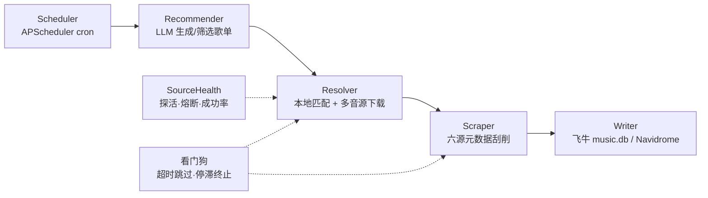

<div align="center">

# TuneSync

**自托管歌单同步引擎 —— 让 NAS 里的音乐库自己长出新歌单**

LLM 生成歌单 → 本地曲库优先匹配 → 多音源替补下载 → 六源元数据刮削 → 自动写入飞牛音乐 / Navidrome

[](https://www.python.org/)
[](https://vuejs.org/)
[](https://fastapi.tiangolo.com/)
[](https://www.docker.com/)
[](tunesync/tests/)
[](LICENSE)

</div>

---

## 它解决什么问题

有 NAS、有本地音乐库（飞牛音乐 / Navidrome），想持续获得**按主题组织好的新歌单**，
但不想手动搜歌、下载、补标签、建歌单。TuneSync 把这条链路做成了全自动闭环：

- 定时触发（或随时手动），大模型按场景/提示词生成仿平台风格的歌单（歌单名 + 曲目清单）
- 本地曲库先匹配，缺的歌从自配音源按音质降级链下载
- 六大元数据源合并刮削：标题/专辑/年份/流派/内嵌封面/同名歌词，一次补齐
- 等目标库自己扫描入库后，在飞牛音乐与 Navidrome 里组建同名歌单，封面自动物化

全程有 Web 管理界面：实时进度、运行历史、失败明细、音源健康，一目了然。

## 核心能力

| 模块 | 能力 |
|---|---|
| **歌单来源** | 三种推送方式：LLM 直接生成 / 乐源拉取 + LLM 筛选 / 乐源拉取直推；49 个预设场景（抖音热歌置顶）+ 自定义提示词 |
| **歌单广场** | 网易云 / QQ / 酷狗 / 酷我 / 咪咕五平台游客直连浏览与搜索，聚合模式并发三源；粘贴链接一键导入并推送 |
| **音源体系** | 通用 HTTP 模板音源 + 兼容落雪（LX-Music）社区音源脚本（Node 沙箱执行）；粘贴脚本/链接即导入，支持批量导入；健康探活 + 熔断 + 成功率统计排序 |
| **刮削引擎** | 网易云 / QQ / 酷狗 / 酷我 / Apple Music / MusicBrainz 六源按优先级合并；简繁归一 + 宽松匹配 + 翻唱/Live 防线；FLAC/Ogg/Opus 封面原生写入 |
| **稳定性** | SQLite 锁冲突指数退避重试、单首超时跳过、停滞看门狗自动终止、失败自动重试（最多 3 次）、全局单工位队列防并发写库 |
| **自动化** | APScheduler 计划任务（cron 自由表达）+ 定时自动刮削补缺 + 本地库定时增量扫描 |
| **可迁移** | 计划任务与关键配置一键导出/导入；推送口令与 LLM 密钥绝不导出 |
| **安全** | 登录校验（可接 SSO 反代头）、密钥掩码回显、LLM 连通先测后存、飞牛库写前自动备份 + schema 指纹校验 |

## 工作原理



五个阶段**只降级不中断**：单首歌失败记 skipped、单音源失败熔断换源、
单场景失败只记该场景错误，全部失败才把整轮判为 failed。

## 快速开始

部署所需的全部文件都在 **`tunesync/deploy/`**（自包含目录），整个文件夹拷到 NAS 即可：

```bash
# 1) 三个前置准备：
#    - 音乐库目录（与飞牛音乐/Navidrome 扫描目录是同一个）
#    - 一个 OpenAI 兼容的 LLM 端点（DeepSeek / 通义 / Kimi / 智谱 / vLLM 均可，
#      部署后在「全局设置」页填写，支持先测连通再保存）
#    - 推送目标：Navidrome 账号 和/或 飞牛音乐 music.db（默认挂载路径见 .env.example）

# 2) 可选：默认已内置中国内地加速源（docker.1ms.run + 阿里云 pip），直连即可构建
cp .env.example .env

# 3) 构建并启动（compose 自动读取同目录 .env）
docker compose up -d --build

# 4) 打开 http://<NAS_IP>:8066 ，首次进入引导创建管理员账号
```

> compose 里**必须保留 `target: runtime`**：Dockerfile 的 test stage 排在最后，
> 不指定会把跑 pytest 的镜像当服务器部署（容器无限重启跑测试）。
> 加速源偶发 502 时重试或在 `.env` 里换备选（`.env.example` 注释里有清单）。

首次启动会自动建库、扫描音乐库、灌入两个开箱即用的公共音源（GD 音乐台 + 酷我）。
所有配置都能在 Web 界面修改，**改完立即生效、无需重启**。

## 文档

| 文档 | 内容 |
|---|---|
| [TuneSync开发文档.md](TuneSync开发文档.md) | 总体设计 + 实现细节 + 当前实现的修订与扩展（第三部分） |
| [tunesync/README.md](tunesync/README.md) | 运维手册：部署细节、音源/LX 脚本配置、歌单广场端点、已知限制与刻意偏离 |

## 本地开发

```bat
tools\setup_env.cmd    :: 安装后端依赖到 .pylibs
tools\run.cmd          :: 启动后端（默认 8066）
tools\test.cmd         :: 后端测试（470+ 用例，外部网络全部打桩）
tools\docker-test.cmd  :: 容器内跑同一套测试（Python 3.12，与生产一致）
```

前端在 `tunesync/frontend/`：`pnpm install && pnpm dev`（开发）/ `pnpm build`（产物输出到
`tunesync/app/static/`，由 FastAPI 托管）。

## 项目结构

```
├── TuneSync开发文档.md      # 设计文档（设计意图 + 当前实现修订）
├── tools/                   # 开发/部署脚本（pack-deploy、docker-test、ipv6_bridge 等）
└── tunesync/
    ├── app/                 # FastAPI 后端（pipeline / recommender / resolver /
    │                        #   scraper / songmeta / platforms / lxbridge / writers / scheduler）
    ├── frontend/            # Vue 3 + Vite + Element Plus 管理界面
    ├── config/              # config.yaml（默认值，UI 覆盖入库）+ categories.yaml（49 场景）
    ├── tests/               # pytest，470+ 用例，外部网络全部打桩
    └── deploy/              # 自包含 NAS 部署目录（Dockerfile + compose + env 模板）
```

## 免责声明

TuneSync 本身不内置任何音乐内容或破解逻辑：歌单广场使用各平台公开的游客接口，
下载依赖用户自行配置的公共/自建音源 API，元数据来自公开接口与开放数据库。
请仅将本工具用于个人已获授权的内容管理，并遵守各平台的服务条款。

## License

[MIT](LICENSE)
